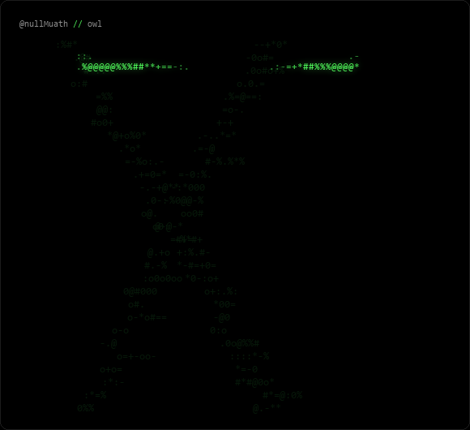
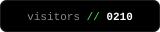

<table border="0">
  <tr>
    <td width="55%" align="center" valign="middle">
      
    </td>
    <td width="45%" valign="middle">
      
"I've always been chasing ghosts"

      
— The Eden Project

    </td>
  </tr>
</table>

## `$ whoami`

<table>
  <tr>
    <td colspan="2"></td>
  </tr>
  <tr>
    <td width="170"><code>name</code></td>
    <td><b>Muath</b> aka <code>@nullMuath</code></td>
  </tr>
  <tr>
    <td><code>role</code></td>
    <td>a humble IT undergraduate · developer &amp; designer</td>
  </tr>
  <tr>
    <td><code>find_me</code></td>
    <td><a href="https://nullmuath.dev">nullmuath.dev</a> &nbsp;·&nbsp; <a href="https://x.com/nullMuath">x.com/nullMuath</a> &nbsp;·&nbsp; <a href="mailto:contact@nullmuath.dev">contact@nullmuath.dev</a> &nbsp;·&nbsp; <a href="https://paypal.me/nullMuath">paypal.me/nullMuath</a></td>
  </tr>
</table>

## `$ ls ~/projects`

<table border="0">
  <tr>
    <td width="44%" align="center" valign="middle">
      
    </td>
    <td width="56%" valign="middle">
      <h2 align="center">Projects</h2>
      

        <a href="https://github.com/nullMuath/ArSL-Recognition"><b>ArSL Recognition</b></a> 
        Real-time Arabic Sign Language letter recognition from a webcam.
      

      

        <a href="https://github.com/nullMuath/CodeDual"><b>CodeDual</b></a> 
        Multiplayer game where two players race to fix the same buggy Java code.
      

      

        <a href="https://github.com/nullMuath/Musannif"><b>Musannif</b></a> 
        Desktop app that organizes messy folders, with a preview and one-click undo.
      

      

        <a href="https://github.com/nullMuath/RSA-java"><b>RSA-java</b></a> 
        RSA encryption and decryption implemented in Java, with a CLI.
      

      

    </td>
  </tr>
</table>

  Other Projects: 
  <a href="https://github.com/nullMuath/DecoratorExample">DecoratorExample</a> &nbsp;·&nbsp; <a href="https://nullmuath.dev">more on nullmuath.dev</a>

## `$ cat stack.txt`

  

## `$ git log --stat`

  

  

